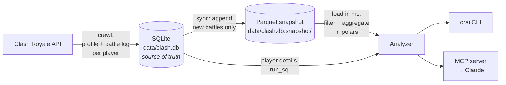

# crai: Clash Royale deck analytics + MCP

`crai` collects real battle data from the Clash Royale API and turns it into answers to deck-building questions, like "what pairs best with Goblin Drill?" or "which card in my deck should I replace?". You ask from the command line, or ask Claude directly through an MCP server.

New here? Read **[How the data pipeline works](#how-the-data-pipeline-works)** first.

## Setup

Requires Python 3.15 (uv installs it automatically).

```sh
uv sync
cp .env.example .env   # then fill in CR_API_TOKEN and CR_MY_TAG
```

To get a token, create a key at <https://developer.clashroyale.com> and whitelist your **public IP** on it (`curl https://api.ipify.org`). **More keys = faster crawls.** Put several keys in `CR_API_TOKEN`, comma-separated (all whitelisting the same IP). Each key gets its own lane of `--concurrency` parallel requests (default 8). A key that gets rate-limited (429) rests on its own while the others continue, and a key that's rejected (403) is disabled with a warning. Each crawl's summary shows requests and 429s per key.

If your IP changes often, you can use the RoyaleAPI proxy: whitelist `45.79.218.79` on the key and set `CR_API_BASE=https://proxy.royaleapi.dev/v1`.

## Collect data

```sh
uv run crai crawl                                  # top 200 + you, 2 hops out, at most 3,000 players
uv run crai crawl --top 1000 --max-players 10000   # bigger
uv run crai crawl --top 0 --depth 0                # just refresh your own battles
```

That's the only command you need. It's safe to re-run any time, and the analytics snapshot updates itself. The API keeps only about your last 30 battles, so crawl regularly (e.g. every 6 hours) to keep all of them.

## Ask questions (CLI)

```sh
uv run crai overview                       # add --json before any command for raw JSON: crai --json overview
uv run crai pairs "hog rider"              # what pairs with Hog (sort: games|adj_win_rate|lift|synergy)
uv run crai counters "x-bow"               # opponent cards that beat X-Bow decks
uv run crai decks --with pekka --without "mega knight" --type pathOfLegend
uv run crai complete hog log "ice spirit"  # finish a partial deck
uv run crai stats --sort adj_win_rate --top-only
uv run crai player                         # you (CR_MY_TAG)
uv run crai my-decks --min-level 15        # proven decks you can build at your levels
uv run crai sql "select battle_type, count(*) from battles group by 1"   # SQLite: every table
uv run crai sql --snapshot "select count(*) from decks where array_contains(cards, 27000013)"  # Parquet: fast
uv run crai schema                         # SQLite schema with column comments
uv run crai schema battles                 # one table + sample rows
uv run crai schema --snapshot              # snapshot tables (decks, cards) + sample rows
```

Card names are fuzzy-matched (`pekka`, `xbow`, `mk`, `log`).

## MCP

By default the server runs over **stdio**: Claude Code launches `crai mcp` as a subprocess, so there's no port and nothing to keep running. `.mcp.json` registers it for this directory. To use it elsewhere:

```sh
claude mcp add clash-royale -- uv run --directory /Users/amirraminfar/Workspace/clashroyale.ai crai mcp
```

For a long-running **HTTP** server instead: `uv run crai mcp --transport streamable-http --port 8765`, which serves `http://127.0.0.1:8765/mcp`.

Every tool declares an output schema. Tables come back **columnar** (`{"columns": [...], "rows": [[...]]}`), about half the tokens of a list of objects, with floats rounded and card IDs dropped. Every win rate has a `margin` (95% margin of error), so the model can tell a real difference from noise.

Tools: `db_overview`, `find_card`, `list_cards`, `card_stats`, `card_pairs`, `card_matchups`, `compare_cards`, `top_decks`, `complete_deck`, `player_profile`, `player_cards`, `decks_for_player`, `refresh_player` (live API), `get_schema`, `run_sql` (read-only SQLite), `run_snapshot_sql` (fast polars SQL over the deck snapshot).

## How the data pipeline works



There are four stages: **crawl → store → snapshot → analyze.** Each stage only reads what the previous one wrote, so you can re-run any of them safely.

### 1. Crawl: decide whose battles to fetch

`crai crawl` does a *breadth-first search* over "who played whom":

| Depth | Players fetched | Where they come from |
|---|---|---|
| 0 (seeds) | Top N Path of Legend players (`--top`), plus you (`CR_MY_TAG`) and any `--tag` | The API's ranking endpoint |
| 1 | Everyone the seeds played against | The seeds' battle logs |
| 2 | Everyone *those* players played against | The depth-1 players' battle logs |

For each player it makes **two API calls**: their **profile** (trophies, clan, card collection with levels, current deck) and their **battle log** (their last ~30 battles, both decks). It also refreshes the full card list at the start.

Limits and rules:
- `--max-players` caps how many players get fetched from the API in one run.
- A player fetched within `--refresh-hours` (default 12) is **not fetched again**. Their opponents are still found in the database, so the crawl keeps expanding through them.
- Friendly battles don't count as connections when deciding who to crawl next.
- Requests are spread across all your API keys (see [Setup](#setup)).
- If one player's request fails (a timeout or 500) or their data is malformed, that player is skipped and retried next run. A **403** (bad token or IP) stops the crawl immediately.
- Only one crawl can run at a time (`data/.crawl.lock`).

### 2. Store: write everything into SQLite

Every battle is written to `data/clash.db`:

| Table | One row per… | What's in it |
|---|---|---|
| `battles` | battle | time, mode (`battle_type`), `deck_selection`, arena, 1v1 or 2v2 |
| `battle_participants` | player in a battle | side (0/1), result, crowns, trophies, tower HP, `deck_key` |
| `participant_cards` | card in a player's deck in a battle | card, level, evolution, deck slot |
| `players` | player | profile details, `is_seed`, when last fetched. Opponents get a row too, with just tag and name, even if never crawled. |
| `player_cards` / `player_current_deck` | card owned / deck slot | collection with levels; current deck |
| `cards` | card | name, elixir, rarity, max level |
| `crawl_runs` | crawl | parameters, counts, status |

**Fast writes.** Battle IDs are sequential integers, and the big per-battle tables are clustered on `battle_id`, so new rows always land at the *end* of each index. Each commit touches a few adjacent pages instead of thousands of scattered ones; with v2's random SHA-1 IDs, commits took ~80% of crawl time. A database created before v3 has to be converted once with `uv run crai upgrade-db`, which keeps the original as `data/clash.v2-backup.db`.

**Battles are stored once.** The same battle appears in both players' logs, sometimes with timestamps a second apart, so a battle with the same participants within 10 seconds counts as the same battle. Side 0 is always the player whose tag sorts first, so both copies look identical.

**Writes are idempotent.** Battles are insert-or-ignore, and players are updated in place. Re-running a crawl never duplicates anything; it only adds new battles and refreshes profiles.

`deck_key` is the deck's 8 card IDs, sorted and joined with `-`. Two players with the same 8 cards have the same `deck_key`, whatever order they put the cards in.

### 3. Snapshot: copy deck data to Parquet for speed

Reading ~1M deck rows out of SQLite takes 2.5–12 s, too slow to do for every question. So the rows analytics needs are copied into Parquet files in `data/clash.db.snapshot/` (~30 MB), which load in ~30 ms.

- **What's in it:** one row per player per **1v1** battle with a full **8-card** deck. That's battle, player, side, cards, score (1 / 0.5 / 0), mode and time. All modes are included (friendlies too); filtering happens at question time.
- **What isn't:** card levels and evolutions, crowns and tower HP. Those stay in SQLite only.
- **Incremental:** the snapshot remembers the last battle it covers. A sync appends only newer battles as a new part file, `decks-<first>-<last>.parquet`. Parts are merged once there are more than 16.
- **When it syncs:** at the end of every crawl, after `refresh_player`, and automatically before any question if it's behind. You never need to run it yourself; `uv run crai snapshot --rebuild` exists in case something looks off.
- **Safety:** a lock file stops the CLI, the MCP server and the crawler from writing at the same moment. New parts are written to a temp file and then renamed, so a half-written file is never read. A migration that deletes battles resets the snapshot.

### 4. Analyze: answer the question

Every question, from the CLI or MCP, goes through the same `Analyzer` (`src/crai/analytics.py`):

1. Check that the snapshot is current (under 1 ms), syncing first if it's behind.
2. Load the snapshot from memory if it's cached, otherwise from Parquet (~30 ms). Then mark which decks belong to seed players (`is_top`). This is looked up fresh from `players` because seed status can change after a battle is stored.
3. Apply your filters: battle types, last N days, top players only. The defaults keep normal (`collection`) decks and drop friendly, clanmate and boat battles.
4. Compute the answer in polars (10–50 ms).

Per-player questions (`player_profile`, `player_cards`) and `run_sql` read SQLite directly, because they need details the snapshot doesn't have. `crai sql --snapshot` / `run_snapshot_sql` run SQL over the snapshot itself (tables `decks` and `cards`) for fast ad-hoc aggregates.

### One battle's journey

1. You crawl. Your battle log includes a win against `#ABC`.
2. The battle is stored: 1 row in `battles`, 2 in `battle_participants` (you won, `#ABC` lost), and 16 in `participant_cards` (8 cards each, plus a row for each player's tower troop).
3. Later `#ABC` is crawled too. Their log has the same battle (maybe 1 second off), and dedup skips it.
4. When the crawl finishes, the snapshot appends 2 rows: your deck with score 1, theirs with score 0.
5. You ask "what pairs with Hog Rider?". Your deck now counts in that answer, along with every other Hog deck.

### What the numbers mean

- **Unit of analysis:** one player's 8-card deck in one 1v1 battle (a "deck appearance").
- **`win_rate`:** a draw counts as half a win.
- **`adj_win_rate`:** (wins + 10) / (games + 20), which pulls small samples toward 50% so a deck that went 3–0 doesn't top the rankings.
- **`margin`:** the 95% margin of error on a win rate, about ±1/√games. A difference smaller than the margin may just be noise.
- **`players`:** how many different players produced the games. If it's small, one strong player can drive the result.
- **Pairs:** `pair_rate` = share of decks with card X that also run Y. `lift` = pair_rate ÷ Y's overall use rate (above 1 means they're deliberately paired). `synergy` = win rate of decks with both minus X's own win rate.
- **Matchups:** the win rate of decks *with* the card when the opponent has card Y.
- **Levels:** `level_normalized` puts levels on the in-game scale (16 = max). The API reports levels per rarity.
- **Correlation, not causation:** these are observed results. Strong players may simply favor certain cards.

### Where everything lives

| Path | What | In git? |
|---|---|---|
| `.env` | API token, your tag | No (secret) |
| `data/clash.db` | SQLite database, the source of truth | No |
| `data/clash.db.snapshot/` | Parquet snapshot; rebuildable from the DB | No |
| `data/.crawl.lock` | prevents two crawls at once | No |
| `src/crai/` | the code (see [Layout](#layout)) | Yes |

## Layout

```
src/crai/models.py      TypedDicts for the API payloads
src/crai/api.py         async httpx client (retries, 429 backoff, concurrency limit)
src/crai/db.py          SQLite schema, migrations, idempotent ingest (stage 2)
src/crai/snapshot.py    incremental Parquet snapshot (stage 3)
src/crai/crawl.py       breadth-first crawler (stage 1)
src/crai/analytics.py   polars analytics (stage 4)
src/crai/cli.py         typer CLI
src/crai/mcp_server.py  MCP server
```

## Development

```sh
uv run ruff format . && uv run ruff check .   # lint + format
uv run ty check                               # types (Astral's ty)
uv run pytest -q                              # tests: no network (httpx.MockTransport)
```

CI runs the same commands (`.github/workflows/ci.yml`).

**Zed**: `.zed/settings.json` uses ty + ruff as the Python language servers (basedpyright and pyright are disabled), with format, import sorting and fixes on save. `.zed/tasks.json` has tasks to run checks, tests (whole file or the symbol under the cursor), crawl, and the HTTP MCP server. Open them with `task: spawn`.

**Python 3.15 features used**: `lazy import` (PEP 810) keeps polars/httpx out of commands that don't need them (CLI import drops from ~175 ms to ~23 ms), `frozendict` (PEP 814), unpacking in comprehensions (PEP 798). From 3.14: deferred annotations (PEP 649, so there's no `from __future__` or `TYPE_CHECKING`) and unparenthesized `except A, B` (PEP 758). Also PEP 695 generics and `type` aliases. The aliases that typer reads at runtime stay plain assignments, because typer can't unwrap `TypeAliasType` yet.
