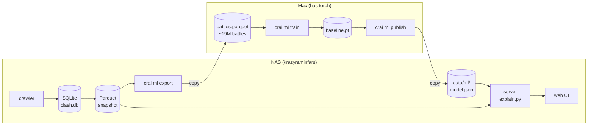
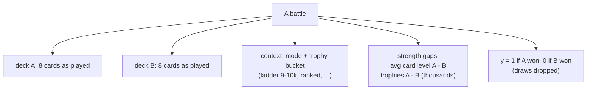
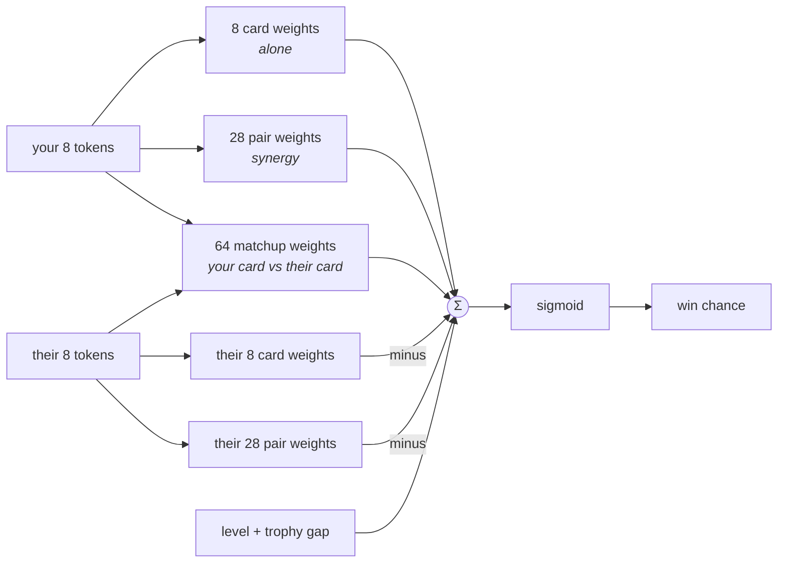
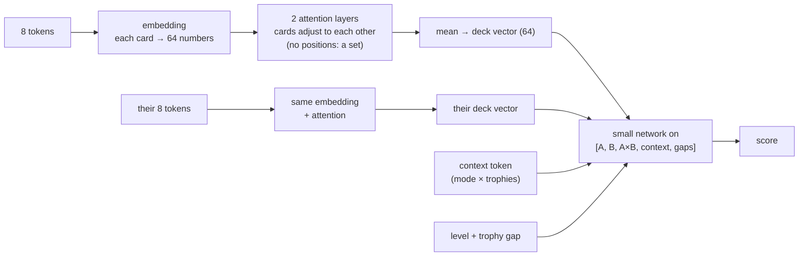
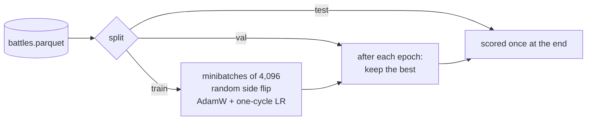
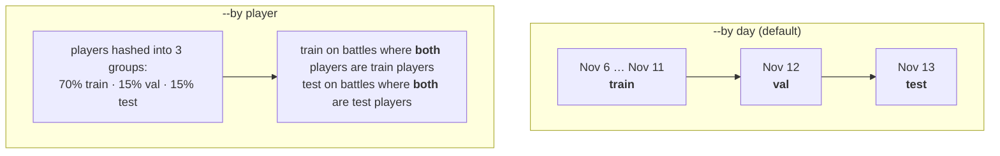
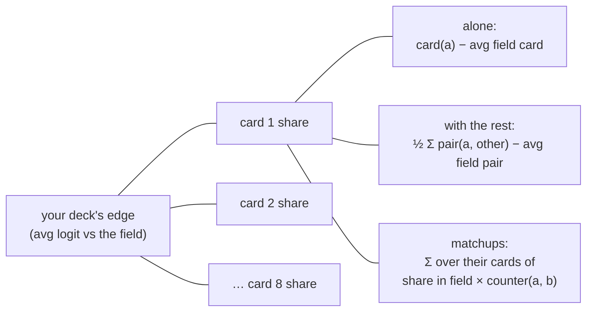
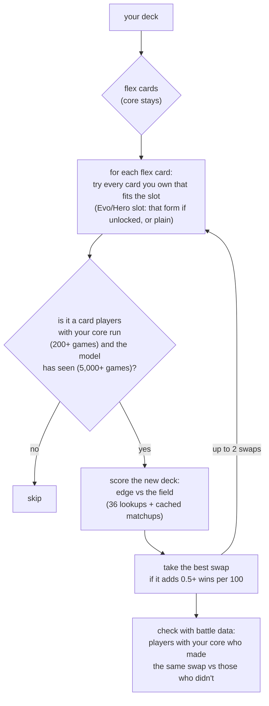

# Deck models

A model that looks at two decks and predicts who wins. Rook uses it to say how a deck stacks up
against the decks at a player's trophies, what each card adds, and whether a suggested swap
helps, and to explain why.

It sits next to the battle-data analysis Rook already does, and doesn't replace it:

| | Battle data (`crai.analysis.insights`) | Deck model (this folder) |
|---|---|---|
| Question | "Did players with your core who swapped X for Y win more?" | "Given these two decks, who wins?" |
| How | Counts and compares win rates of groups of decks | Learned weights, summed |
| Good at | Direct evidence, no assumptions | Any deck, even one nobody plays; says *why* |
| Weak at | Needs many games of that exact package | Only knows cards, pairs and one-on-one counters |

The swap card shows both. When they disagree, that's worth knowing.

## The whole pipeline



The NAS has the data but no PyTorch, and the Mac has PyTorch but not the data. So:

1. **Export** runs on the NAS (polars only) and writes one row per battle.
2. **Train** runs on the Mac (Apple GPU: about a minute for the baseline, several for DeckNet).
3. **Publish** turns the trained baseline into plain JSON weights (~1 MB).
4. The **server** reads `model.json` with plain Python: no torch, ~0.1 s per report once warm.

## 1. Data: a battle as tokens

Each battle becomes one row: both decks, where it was played, how strong each account is, and
who won.



**Tokens.** A card as played is a *token*, a word in the model's vocabulary. Every card gets
four tokens, one per form:

```
card_id ──► first token f      Knight          = f
                                Evo Knight      = f + 1
                                Hero Knight     = f + 2
                                Evo + Hero      = f + 3
```

So "Evo Knight" and "Knight" are different words, and the model learns them separately. A card
the vocabulary doesn't know (released after training) becomes token 0 (`PAD`) and is ignored.

Order inside a deck doesn't matter. The Evolution/Hero slot is already part of the token, so a
deck is a **set of 8 tokens**.

Code: [`data.py`](data.py) (`export`, `tokens`, `context`, `strength`).

## 2. The models

All three predict `P(A beats B)` and are **antisymmetric** by construction:

```
logit(A, B) = s(A, B) - s(B, A)      so   P(A beats B) = 1 - P(B beats A)
```

Which side a battle lists first can't change the answer.

### Strength (the yardstick)

It ignores the decks completely and uses only the card-level and trophy gaps. It answers "how
much can you predict without knowing the decks?" Every deck model has to beat it, or the decks
aren't adding anything.

### Baseline: the one in the product

A logistic regression: one learned number (weight) for each thing below, and the prediction is
their sum.



In symbols:

```
own(D)        = Σ card(d)  +  Σ pair(d, d')                 (8 cards + 28 pairs)
counter(a, b) = vs(a, b) - vs(b, a)
logit(A, B)   = own(A) - own(B) + Σ_a Σ_b counter(a, b) + w · (level gap, trophy gap)
```

About 190 card, 17,000 pair and 35,000 matchup weights are learned (only pairs and matchups
that actually occur get a weight).

Why it's the one in the product:
- **Explainable.** Every prediction is a sum, so it splits exactly into reasons. See
  [Explanations](#4-explanations).
- **Nearly as accurate.** It's within 0.6 points of DeckNet.
- **Light.** It's just a lookup table, so the NAS runs it without torch.

**L2 (`--l2`).** Without it, a strong card's strength can hide in its 7 pair weights instead of
its own weight. The penalty shrinks pair and matchup weights toward zero, so they only hold
what's *extra*: real synergy and counters. 0.03 costs 0.1 points of accuracy.

Code: [`model.py`](model.py) (`Baseline`).

### DeckNet: the deep one (experimental)



It can learn things the baseline can't, like three-card combos or "this card is good *in this
kind of deck*". But it's a black box, and it's only slightly more accurate. It isn't used in the
product.

Code: [`model.py`](model.py) (`DeckNet`), about 137k parameters.

## 3. Training and testing



- **Loss:** log loss (binary cross-entropy). Always guessing 50% scores 0.693.
- **Side flip:** each batch is randomly mirrored (A↔B, gaps negated, y→1−y), so the model can't
  learn "side A tends to win".
- **Checkpoint:** the epoch with the best validation log loss is kept.

### Two ways to hold battles out (`--by`)



- **By day** asks "does it predict tomorrow?", which is how it's used. A day still being crawled
  is skipped, so the test day is always a full one.
- **By player** asks "did it learn decks, or did it learn to recognize strong players?" If it were
  recognizing players, it would do worse on players it never saw. It doesn't.

### Results (19.3M battles, Nov 6–13)

| Model | Newest day | Unseen players |
|---|---|---|
| Coin flip | 50.0% | 50.0% |
| Strength only (levels, trophies) | 54.9% | 55.5% |
| Baseline | 64.6% | 65.5% |
| Baseline, L2 0.03 (**published**) | 64.5% | — |
| DeckNet | 65.2% | 66.1% |

The decks add about 10 points over levels and trophies, and the model learned decks, not
players. The calibration error is about 0.002 to 0.008, so when it says 60%, about 60% of
those battles are won.

Code: [`train.py`](train.py).

## 4. Explanations

The server ([`explain.py`](explain.py)) answers questions about one player's deck.

**The field.** It samples 1,000 decks played near the player's trophies, the same range as the
rest of the report (falling back to every trophy level). It assumes **equal levels and
trophies**, so the answer is about the deck, not the account.

**Win chance.** This is the average of `sigmoid(logit(your deck, d))` over the field decks.

**What each card adds.** The baseline is a sum, so the deck's average logit against the field
splits *exactly* into one share per card:



Each pair is split half and half between its two cards. The shares add up to the whole edge,
so the bars are the real breakdown, not an approximation.

**Units.** Shares are in log-odds. The page shows them as *wins per 100 games* near the deck's
win chance p: `share × p(1−p) × 100`. That's the usual slope of the sigmoid, accurate for small
changes.

**Best and worst against.** For each opponent card in at least 5% of field decks, this sums
`counter(your card, it)` over your 8 cards.

**Swap verdict.** It builds the new deck (current minus the out-cards, plus the in-cards) and
compares the two win chances. It then picks the biggest reasons:
- the pair that changed most, a synergy gained or lost;
- the opponent card the swap handles most differently, weighted by how common it is.

## 5. Recommendations

The swap card shows the model's own suggestion ([`explain.recommend`](explain.py)):



- **Greedy, one swap at a time.** Each step takes the swap that raises the deck's edge most,
  until nothing adds half a win per 100, up to two swaps.
- **Kept to real decks.** The model adds up what it learned, so for a combination nobody plays
  it would extrapolate happily: it once proposed four cards for "+12 per 100". Candidate cards
  must be ones players with the same core actually run, and ones the model has seen often.
- **Checked against battle data.** The same core-based head-to-head as the data's own
  suggestions. "Unknown" means too few players have made that exact swap to say.
- **Alternatives.** The best single-card swap for each flex card is listed too.

## Retraining

```sh
# On the NAS (in a throwaway rook container): export the last 8 days
crai ml export --days 8 --out /app/data/ml/battles.parquet

# Copy battles.parquet + battles.vocab.json to data/ml/ on the Mac, then:
uv run --group ml crai ml train --kind baseline --l2 0.03        # ~1 min
uv run --group ml crai ml train --kind strength                  # the yardstick
uv run --group ml crai ml train --kind decknet                   # optional, several minutes
uv run --group ml crai ml train --kind decknet --by player       # the unseen-player check

uv run --group ml crai ml publish --checkpoint data/ml/baseline.pt
# Copy data/ml/model.json to /volume2/docker/rook/data/ml/model.json on the NAS.
# The server notices the new file on its own.
```

Retrain when new cards come out (until then they're unknown tokens) or when the meta shifts.

## Limits

- It knows **cards, pairs and one-on-one counters**, not three-card combos or how a deck is
  played. DeckNet tries to learn more, for little gain so far.
- **Skill is invisible.** At 65%, about one battle in three goes the other way. It's a statement
  about averages.
- Shares assume **equal card levels**. The model knows levels matter, but the deck view leaves
  them out on purpose.
- **Wins per 100** is a linear reading of the sigmoid, close for small effects and rough for
  big ones.

## Files

| File | Needs | What |
|---|---|---|
| [`data.py`](data.py) | polars | export battles as tokens; vocabulary |
| [`model.py`](model.py) | torch | Strength, Baseline, DeckNet |
| [`train.py`](train.py) | torch | splits, training loop, scores |
| [`publish.py`](publish.py) | torch | baseline → `model.json` |
| [`explain.py`](explain.py) | — | server side: win chance, shares, swap verdicts |
| `../cli/ml_commands.py` | | `crai ml export / train / publish` |
